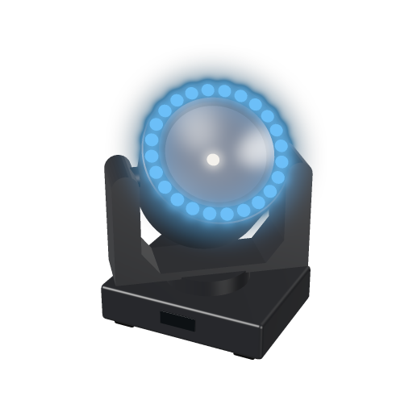
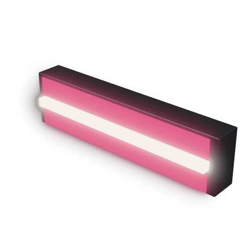
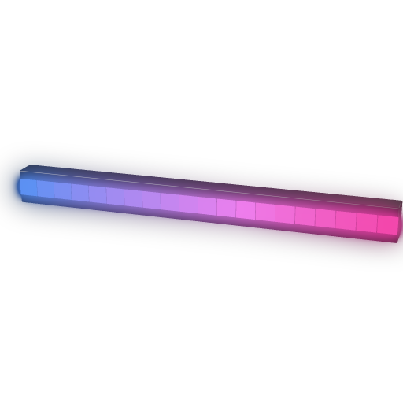

# PHAGE fixtures

Sentinel's own fixture types, written by `tools/phage_gdtf.py` from the constants PHAGE's renderer draws its
fixtures with. Rerun the script after changing a fixture's shape; it rewrites the GDTFs, their meshes,
thumbnails and this sheet. Photometry is a design figure, not a measurement. GDTF frame: hanging, X right,
Y away from the viewer, Z up, beam along -Z, origin at the mounting face.

## Sentinel Halo Beam

LED beam moving head with a 24-cell RGB halo around its lens: PHAGE's mover, written from the shapes its renderer draws. A Sentinel example fixture, not a model of any manufacturer's product.

- **Size:** 468 x 322 mm footprint; head 333 mm; pan axis 128 mm and tilt axis 386 mm below the mounting face
- **Optics:** LED RGB beam engine, 8,200 lm, zoom 1-20 deg (3 deg at home), frost; halo of 24 RGB cells, 110 deg
- **Motion:** pan 540 deg, tilt 270 deg, 16 bit
- **Cells:** Halo cell 1 sits at the head's +Y (away from the viewer at home); cells run counter-clockwise seen from in front of the lens, 15 deg apart

### Standard 15ch

| Ch | Geometry | Function | DMX |
|---|---|---|---|
| 1+2 | Yoke | Pan | 0-65535 (-270 to 270) |
| 3+4 | Head | Tilt | 0-65535 (-135 to 135) |
| 5 | Beam | Beam dimmer | 0-255 |
| 6 | Beam | Shutter / strobe | 0-7 closed; 8-15 open; 16-239 strobe 1-25 Hz; 240-255 open 2 |
| 7 | Beam | Beam R | 0-255 |
| 8 | Beam | Beam G | 0-255 |
| 9 | Beam | Beam B | 0-255 |
| 10 | Beam | Zoom (1-20 deg) | 0-255 (1 to 20) |
| 11 | Beam | Frost | 0-255 |
| 12 | Ring | Halo dimmer | 0-255 |
| 13 | Ring | Halo R | 0-255 |
| 14 | Ring | Halo G | 0-255 |
| 15 | Ring | Halo B | 0-255 |

15 channels.

### Pixel 83ch

| Ch | Geometry | Function | DMX |
|---|---|---|---|
| 1+2 | Yoke | Pan | 0-65535 (-270 to 270) |
| 3+4 | Head | Tilt | 0-65535 (-135 to 135) |
| 5 | Beam | Beam dimmer | 0-255 |
| 6 | Beam | Shutter / strobe | 0-7 closed; 8-15 open; 16-239 strobe 1-25 Hz; 240-255 open 2 |
| 7 | Beam | Beam R | 0-255 |
| 8 | Beam | Beam G | 0-255 |
| 9 | Beam | Beam B | 0-255 |
| 10 | Beam | Zoom (1-20 deg) | 0-255 (1 to 20) |
| 11 | Beam | Frost | 0-255 |
| 12 + 3(n-1) | Ring Cell | Halo cell R | 0-255 |
| 13 + 3(n-1) | Ring Cell | Halo cell G | 0-255 |
| 14 + 3(n-1) | Ring Cell | Halo cell B | 0-255 |

83 channels.

## Sentinel Linear Strobe

1 m linear strobe: a tunable white LED tube between two RGB plates. PHAGE's strobe, written from the shapes its renderer draws. A Sentinel example fixture, not a model of any manufacturer's product.

- **Size:** 1000 x 260 x 130 mm; the tube stands 37 mm proud of the face
- **Optics:** tunable white LED tube, 6500-2200 K, 8 x 2,600 lm, strobe to 25 Hz; two RGB plates either side, 120 deg
- **Cells:** Plate 1 is the -Y plate, Plate 2 the +Y plate; tube and plates are 8 segments each, left to right in X

### Standard 7ch

| Ch | Geometry | Function | DMX |
|---|---|---|---|
| 1 | Tube | Tube dimmer | 0-255 |
| 2 | Tube | Shutter / strobe | 0-7 closed; 8-15 open; 16-239 strobe 1-25 Hz; 240-255 open 2 |
| 3 | Tube | Tube colour temperature (6500-2200 K) | 0-255 (6500 to 2200) |
| 4 | Plates | Plate dimmer | 0-255 |
| 5 | Plates | Plate R | 0-255 |
| 6 | Plates | Plate G | 0-255 |
| 7 | Plates | Plate B | 0-255 |

7 channels.

### Pixel 10ch

| Ch | Geometry | Function | DMX |
|---|---|---|---|
| 1 | Tube | Tube dimmer | 0-255 |
| 2 | Tube | Shutter / strobe | 0-7 closed; 8-15 open; 16-239 strobe 1-25 Hz; 240-255 open 2 |
| 3 | Tube | Tube colour temperature (6500-2200 K) | 0-255 (6500 to 2200) |
| 4 | Plates | Plate dimmer | 0-255 |
| 5 | Plate 1 | Plate 1 R | 0-255 |
| 6 | Plate 1 | Plate 1 G | 0-255 |
| 7 | Plate 1 | Plate 1 B | 0-255 |
| 8 | Plate 2 | Plate 2 R | 0-255 |
| 9 | Plate 2 | Plate 2 G | 0-255 |
| 10 | Plate 2 | Plate 2 B | 0-255 |

10 channels.

## Sentinel Pixel Batten 1000

1 m RGB pixel batten, 20 pixels at 5 cm pitch behind a diffuser: the unit PHAGE's pixel runs are built from, written from the section its renderer draws. A Sentinel example fixture, not a model of any manufacturer's product.

- **Size:** 1000 x 90 x 60 mm
- **Optics:** 20 RGB pixels at 50 mm pitch, 110 deg diffused
- **Cells:** Pixel 1 is at -X (left in the front view); pixels run left to right, three channels each

### Pixel 60ch

| Ch | Geometry | Function | DMX |
|---|---|---|---|
| 1 + 3(n-1) | Pixel | Pixel R | 0-255 |
| 2 + 3(n-1) | Pixel | Pixel G | 0-255 |
| 3 + 3(n-1) | Pixel | Pixel B | 0-255 |

60 channels.

### Bar 4ch

| Ch | Geometry | Function | DMX |
|---|---|---|---|
| 1 | Body | Dimmer | 0-255 |
| 2 | Body | R | 0-255 |
| 3 | Body | G | 0-255 |
| 4 | Body | B | 0-255 |

4 channels.
