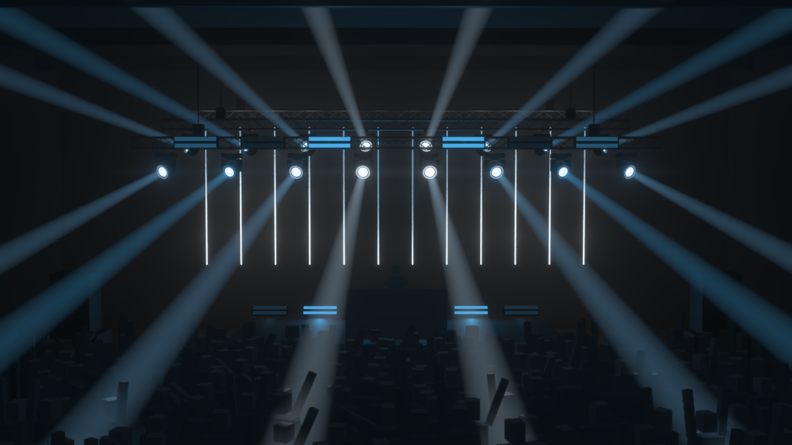
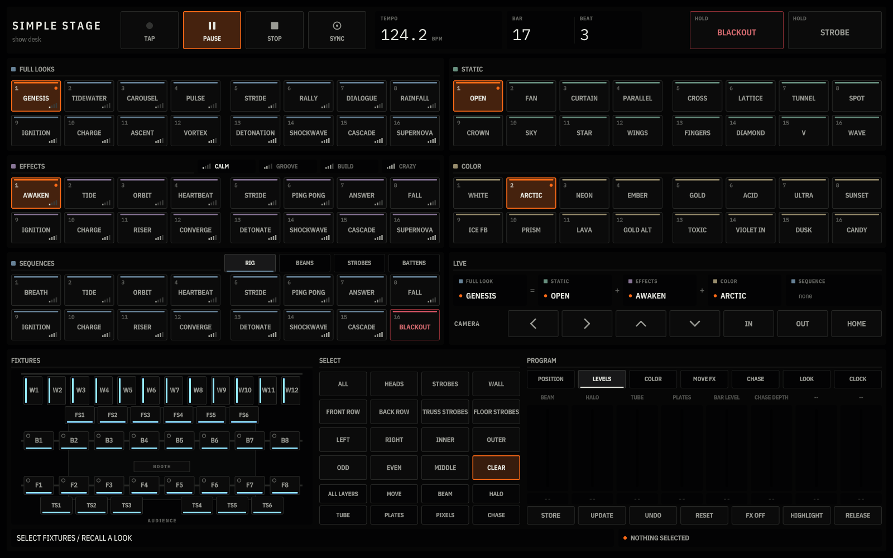

# SIMPLE STAGE



A club stage in Sentinel, built to be played. Three flown truss lines of stock F34 hang on chain hoists over a 1 m
deck with the DJ's booth at its front. They carry 76 GDTF fixtures in 7 DMX universes, over a crowd in a 22 x 30 m
room:

- the FRONT ROW, eight Halo Beams hung over the front of the deck, with six Linear Strobes on the truss's face;
- the BACK ROW, eight more Halo Beams hung higher behind the DJ;
- the WALL behind the DJ, twelve vertical runs of four Pixel Batten 1000s;
- the FLOOR line, six Linear Strobes standing along the back of the deck.

What you see is what its DMX says. It ships a complete show and a desk to play and program it:

- 16 STATIC beam shapes, 16 COLOR looks (8 palettes x routings), 16 EFFECTS in four energy tiers and 16 FULL LOOKS.
- 15 SEQUENCES and BLACKOUT, played on the whole rig or on one fixture type.
- A programmer that drives every light on its own: pick fixtures on a map of the stage, narrow to a layer, move the
  faders, and STORE the result to any pad.

It is the simple sibling of [PHAGE](../phage_stage/README.md) and runs on the same show system: the Script-node
surface, the layered programmer, the layered preset banks, the Push 2 runtime and a desk. Its rig, plot, looks,
palettes and venue are its own. Every look is listed in [LOOKS.md](docs/LOOKS.md). It needs Sentinel 0.6.4 or later (its Fixture Rig
node). A Push 2 is optional: `SS_Desk` plays everything with the mouse.

## First run

1. Open `simple_stage.sentinel`. The program image is `SS_Renderer`. The project opens on FULL LOOK 01 GENESIS
   (STATIC OPEN, EFFECTS AWAKEN, COLOR ARCTIC) with the clock running, seen from front of house. HOME on the desk, or
   the `Frame - Program FOH` preset on `SS_Camera`, returns to that view.
2. Open the `SS_Desk` panel (the window toggle in its node header). It fills its window and scales to any size.

### The desk



Top to bottom:

- **Transport and holds:** TAP (its lamp flashes on the beat), PLAY / PAUSE, STOP, SYNC, the tempo, bar and beat.
  BLACKOUT and STROBE act while held.
- **The looks.** Four banks of 16: FULL LOOKS, STATIC, EFFECTS and COLOR, each with its identity colour on a tab
  across its pads. FULL LOOKS and EFFECTS carry their energy tier as a mark of one to four bars (CALM, GROOVE, BUILD,
  CRAZY), and the tier legends light with the effect that is up.
- **SEQUENCES.** 15 sequences and BLACKOUT. The tabs in its header pick what they play on: RIG (every fixture type),
  BEAMS, STROBES or BATTENS. A tab carries a dot while a sequence of its kind is up, so you can run BEAMS on STRIDE
  under STROBES on DETONATE.
- **LIVE** spells out what is up: FULL LOOK = STATIC + EFFECTS + COLOR, then the sequence.
- **CAMERA:** the arrows orbit between 40 authored points round the room (8 positions x 5 heights), IN and OUT zoom,
  HOME returns to front of house, on the stage's centre line.
- **The programmer** (below).

Amber means live or picked, and nothing else: a lit look, the selection, the beat, an armed STORE. A FULL look lights
its own pad and the three parts it was built from; recalling any one part afterwards unlights the FULL pad, because
the rig is no longer that look. The lit set is saved with the project. Red is only ever BLACKOUT.

### Programming individual lights

The programmer edits the same program the looks recall, fixture by fixture and layer by layer.

1. **Pick fixtures** on the FIXTURES map, the plot seen from above with the audience at the bottom, back to front:
   - the wall's twelve runs (W1-W12);
   - the floor strobes (FS1-FS6);
   - the back row (B1-B8), then the booth;
   - the front row (F1-F8) and the truss strobes on its face (TS1-TS6).

   A click toggles one fixture. SELECT groups replace the selection: ALL, HEADS, STROBES, WALL, FRONT ROW, BACK ROW,
   TRUSS STROBES, FLOOR STROBES, LEFT, RIGHT, INNER, OUTER, ODD, EVEN, MIDDLE, and CLEAR. A group lights while the
   selection holds all of it. Each fixture pad shows the colour its palette slot plays.
2. **Narrow to a layer**, if you need one. Every fixture is programmed as layers:

   | Fixture | Layers |
   |---|---|
   | Halo Beam | MOVE (pan, tilt, movement), BEAM (the beam's dimmer and chase), HALO (the 24-cell ring) |
   | Linear Strobe | TUBE (the white tube), PLATES (the two colour plates) |
   | Wall run | PIXELS (its content), CHASE (a chase that dips the content) |

   ALL LAYERS selects whole fixtures again. A fixture with only some layers selected shows a thin amber edge.
3. **Pick an attribute bank** (POSITION, LEVELS, COLOR, MOVE FX, CHASE, LOOK, CLOCK). The eight faders show only the
   attributes the selection has, packed left, each named for what it drives on those fixtures (BEAM, HALO, TUBE,
   PLATES...), with the selection's value under it.
   - A **continuous** fader (pan, tilt, levels, sizes, spread, width, offset) moves every selected fixture by the
     same amount, so a fan stays a fan.
   - A **stepped** fader (palette slot, lanes, a layer's LOOK, order, direction) sets every selected fixture to the
     step under the cap.
   - One drag is one undo step.
4. **HIGHLIGHT** puts the selected fixtures at full open white whatever the look, so you can find the one you are
   programming. Press it again to release.
5. **STORE**, then press any look pad, and the programmer is stored there:

   | Bank | What it keeps |
   |---|---|
   | STATIC | the selected fixtures' aim and levels (the whole rig when nothing is selected) |
   | EFFECTS | the selected fixtures' effect fields and the strobe clock |
   | COLOR | the selected fixtures' palette routing and the palette library |
   | FULL LOOKS | everything, with the parts that are lit |
   | SEQUENCES | the types the sequence tab plays on |

   UPDATE re-stores the last pad you recalled or stored. RESET puts the selected fixtures back to the last recalled
   look, FX OFF stops their effects, and RELEASE puts the whole programmer back. UNDO steps back through 32 edits.

The `SS_Lighting` canvas selects fixtures too, by clicking on its plan, and it stays in step with the programmer. A
Push 2 drives the same programmer with its encoders (RIG page).

### Playing a set

Each family has a job. The two rows draw the shapes, the wall carries the graphics (chevrons and chases out from its
centre, a mirrored equaliser, rain falling down it, ripples, climbs), the floor strobes throw the DJ into silhouette
against the wall, and the truss strobes hit.

Two rules run through every look. **Symmetry:** every shape, chase, colour routing and move is its own mirror image
about the centre line, and `tools/ss_looks.py` checks it field by field when it compiles the looks. **Stillness:** a
STATIC shape is the picture, so most effects leave the heads where it put them. A formation look holds a symmetric
formation for bars at a time and glides to the next, landing on a downbeat. ORBIT circles, the builds lift the heads
with the ramp, and only SUPERNOVA lets every head roam. [docs/LOOKS.md](docs/LOOKS.md) says what each look does.

The four EFFECTS tiers are a dynamic range:

| Tier | Clock | What happens |
|---|---|---|
| CALM | the 16-beat phrase | steady beams under slow light; heads still or gliding a formation once a phrase, ORBIT circles |
| GROOVE | kick, snare and off-beat | beams re-hit on the kick, white tube hits on 2 and 4; heads still or stepping formations |
| BUILD | a 16-beat ramp | restarts on the beat after its recall: brightness rises from 30%, heads lift, the pulse rate doubles each quarter |
| CRAZY | kick | bursts, shockwaves and cascades over steady halos; the strobes let go; formations snap on the bar |

Fire a BUILD look 16 beats before the drop and land on a CRAZY one. The ramp holds at its top until the next recall.
The banks mix: recall a FULL look, then change its COLOR or its EFFECTS tier underneath it.

### Push 2

Optional. Put it in User mode and close anything else that drives its display. `SS_Push2_Display` drives the
screen. The display pages are SEQUENCE (a step sequencer for the rhythm lanes), GLOBAL (master, exposure, bloom,
haze), RIG (the programmer's encoders and the look pads) and COLOR. On the RIG page, Octave Up and Down page the pads
between page 1 (STATIC, EFFECTS, COLOR, FULL) and page 2 (SEQUENCES: RIG, BEAMS, STROBES, BATTENS). The Push and the
desk drive the same programmer and can be used together.

## Automation (agents, MCP, scripts)

Everything the desk does can be done through state. Write a command to `/sentinel/pipelines/SS_Surface/state/rig_command`,
prefixed with a new id of your choice; the Surface answers in `rig_command_ack` as `<id>:accepted` or `<id>:<error>`.
Send one at a time and wait for its ack: the Surface handles only the latest string.

| Command | Effect |
|---|---|
| `<id>\|tempo\|<tap\|play\|stop\|sync\|start\|pause>` | Transport |
| `<id>\|tempo\|bpm\|<value>` | Set the tempo |
| `<id>\|preset\|recall\|<bank>\|<1-16>` | Recall a pad. Banks: `complete`, `static`, `effects`, `color`, `rhythm`, `sequence`, `seq_heads`, `seq_strobes`, `seq_battens` |
| `<id>\|preset\|store\|<bank>\|<1-16>` | Store the programmer into a pad |
| `<id>\|select\|<ids>[\|toggle]` | Select by slot, row or group name, comma-separated (`all`, `movers`, `front_row`, `floor_strobes`, `beam`...) |
| `<id>\|bank\|<1-7 or id>` | The attribute bank the Push and the desk show |
| `<id>\|encoder\|<attribute>\|<value>\|absolute` | Set an attribute on the selection (omit `absolute` to move it) |
| `<id>\|rows\|<static\|effects>\|<0-1>\|<packed>` | Paste one packed 32-slot partition into the programmer (undoable, not stored) |
| `<id>\|momentary\|<blackout\|strobe>\|<1\|0>` | Hold or release |
| `<id>\|camera\|<left\|right\|up\|down\|in\|out\|home\|time\|save\|reset>` | Orbit camera |
| `<id>\|pads\|<1-2>` | The Push's pad page |
| `<id>\|group\|<1-8>\|<name>` | Store the selection as a custom group |
| `<id>\|<undo\|reset_selected\|release>` | Programmer undo, restore the selection, release |

`active_looks` in the same state folder reports the lit pads, for example
`static=static 1;effects=effects 1;color=color 2;complete=complete 1`.

Tools (Python; the ones that talk to Sentinel use the workspace's own `.mcp.json`):

| Tool | What it does |
|---|---|
| `tools/ss_review.py` | Recalls looks as the desk does and writes contact sheets and filmstrips to `captures/looks/`; `steady` pastes neutral effects for repeatable frames |
| `tools/ss_verify.py` | Recall exactness: every FULL look and RIG sequence must reach `SS_Program` exactly as generated, field by field |
| `tools/ss_looks.py` | Compiles every look into `presets/`, the pad titles and [LOOKS.md](docs/LOOKS.md) |
| `tools/ss_desk.py` | Generates the desk's manifest, layout tables and the Surface's control map from one table |
| `tools/ss_stage.py` | Solves the trusses, places and patches the fixtures, writes the MVR, the stage header (with the outline the canvases draw) and the fixture catalog |
| `tools/ss_layout.py` | The slot and row layout every node shares; `--check` reports any literal that disagrees with it |
| `tools/ss_program.py` | Generates `SS_Program`'s 160 rows x 17 attributes |

A paused clock darkens every lane-driven fixture, and movers slew, so give a position change about 2 s before a
still. Judge an effect over one fixed STATIC and COLOR.

## Component map

| Node | Type | Role |
|---|---|---|
| `SS_Stage` | Module | The stage: truss members, solids (deck, booth, the DJ, hoists) and every fixture mount (`Mounts`, `Bar Pieces`, `Structure`); its canvas is an axonometric with each part's SKU and each fixture's slot |
| `SS_Rig` | Fixture Rig | The rig authority: `assets/simple_stage.mvr` and the three GDTFs in `assets/gdtf/` |
| `SS_Clock` | Conductor | Musical time (beat, BPM, running) |
| `SS_Show` | Module | The show state: rhythm lanes, BUILD and PHRASE, palettes and the strobe clock |
| `SS_Program` | Module | The packed program: 160 rows x 17 attributes, committed as one revision |
| `SS_Lighting` | Module | The console: the fixture table from the rig, motors, optics, pixel content and the DMX encode; its canvas selects fixtures |
| `SS_Venue` | Module | The club: walls, ceiling steel, PA, bar, FOH riser and a crowd of about 500 |
| `SS_Haze` | Module | The hall's air and the haze it carries, simulated: four hazers, the rig's heat, the stage fans, the house air; publishes the `Haze Field` the renderer lights |
| `SS_Camera` | Camera | The view the Surface orbits |
| `SS_Renderer` | Module | Decodes the DMX through each GDTF and draws it: beams in the simulated haze, halos, strobes, pixels, the truss, the room |
| `SS_Surface` | Script | The show surface: programmer, preset banks, Push 2 runtime, the desk's brain |
| `SS_Desk` | Module | The desk panel |
| `SS_Push2_Display` | Push 2 Display | The Push 2 screen |

```text
SS_Stage ─ Mounts, Bar Pieces, Structure ─> SS_Lighting, SS_Venue, SS_Renderer
SS_Rig ─ Fixtures, FixtureRender ─> SS_Lighting, SS_Renderer
SS_Clock ─> SS_Show ─> SS_Lighting, SS_Renderer        SS_Program ─> SS_Lighting
SS_Lighting ─ DMX, Pose ─> SS_Renderer ;  SS_Lighting ─ LED pixels ─> SS_Venue ─> SS_Renderer
SS_Venue, SS_Lighting ─ Rig Fixtures, SS_Show ─> SS_Haze ─ Haze Field ─> SS_Renderer
SS_Desk ─ panel ─> SS_Surface ─ desk_feedback ─> SS_Desk ;  SS_Surface ─ display ─> SS_Push2_Display
```

## The rig

- **Trusses:** three 12 m lines of stock F34 (four 3 m sections each), flown from the ceiling steel on two chain
  hoists each: the front line at 5.6 m over the front of the deck, the back line at 6.2 m behind the DJ, the wall
  line at 6.7 m upstage. An 8 x 1 x 4.5 m deck with the DJ's booth at its front edge and the DJ behind it. Solved by
  `tools/truss_parts.py` (vendored from small_stage), checked geometrically, never structurally.
- **Fixtures:** every Halo Beam hangs below its truss, in two rows of eight at 1.5 m: the front row fans onto the
  crowd, the back row throws a flatter, wider fan over it. Six Linear Strobes on the front truss's face sit between
  the front heads; six more stand on the deck along its back edge, tilted 25 degrees toward the dancefloor. The wall
  is twelve runs at 1 m, each four Pixel Batten 1000s (4 m) hung on a drop below the wall truss.
- **Patch:** universe 1 the heads (Standard 15ch, 1.1-1.240) and the strobes (Standard 7ch, 1.241-1.324); universes
  2-7 the wall's 48 battens (Pixel 60ch, eight to a universe). FixtureID = slot + 1 for heads and strobes,
  10000 + run x 100 + unit for battens. The full sheet is [PATCH.md](assets/PATCH.md).
- **Slots:** heads 0-31, strobes 32-47, runs 48-63, with room for guests. A fixture added to `SS_Rig` takes a free
  slot of its role, plays, encodes and draws with no other edit.
- **DMX:** `SS_Lighting` publishes the encoded universes on its `DMX` port. The project sends nothing out: add a DMX
  Out node on that port (Art-Net or sACN) to drive a real rig.

The renderer reads each fixture's RGB as linear LED output, as a real emitter is, so the look generator linearises
every palette colour into DMX; `(255, 40, 10)` sent raw shows orange, its linear `(255, 4, 0)` the red it was picked as.

## The haze

The haze is a fluid simulation, after the volumetrics a friend of the project built for his own show on this stage
(EmberGen's method: Stable Fluids on a staggered grid, MacCormack advection with Selle's limiter, Boussinesq
buoyancy, vorticity confinement and a multigrid pressure projection). The physics is his; `SS_Haze` rebuilds the
storage for this host, as structured buffers each pass reads and writes in place.

- **The hall's air** is 88 x 40 x 120 cells (0.25 m in the 22 x 30 m room), sized from the hall `SS_Venue`
  publishes. The deck and the DJ's booth are solid; the air goes round them.
- **The haze** rides on a grid twice as fine (1/8 m), carried by that air.
- **Four hazers** stand on the deck: two upstage behind the DJ, two at its downstage corners. Each puffs a cloud
  every 6-12 s on its own cycle, over a low trickle. All four fire together on the drop (the frame a BUILD lands),
  or while **Hazers Full** is held.
- **The rig's heat** lifts the haze: about 0.6 kW per moving head, with the crowd's heat as a warm layer.
- **Two stage fans** throw the clouds out over the booth into the front rows. The house air turns over the
  room, and slow drafts keep it moving.

`SS_Renderer` lights what the sim publishes:

- Every beam sample takes the density where it lies, with flow-carried wisps finer than the grid.
- Each sample is dimmed by the haze between it and the lens, and between it and the eye.
- A puff from a hazer makes the beams uneven where they cross it, and a cloud near a lens dims the beam beyond it.
- **Simulated haze** at 0, or the `Haze Field` unlinked, returns the even haze the Haze control always described.

The `SS_Haze` canvas is its instrument: the field averaged through the hall, in plan over long section on one z
axis, with the deck, the booth, the fans and the four hazers. A hazer is drawn in the accent only while it is in a
burst. The **View** switch shows the haze, the air's speed, or its warmth. The readout column gives:

- the mean and densest haze in the hall;
- the fastest air and the mean warmth;
- how much of the air's divergence the pressure solve leaves: a few percent in a healthy solve, red above 25%.

The same numbers are control outputs: `haze_mean`, `haze_peak`, `air_speed`, `divergence_left` and `all_together`.

The `Haze Field` is one 2048 x 2200 RGBA16F texture: this frame's haze, the air and the wisp noise as atlases of z
slices. Its layout and the grid's place in the hall are one header both nodes include, `modules/_shared/ss_haze.hlsli`.

## Node presets

- **`SS_Camera`: `Frame - Program FOH`**, camera only: the composed front-of-house view, the desk's HOME. It sits
  10 cm off the centre line: a camera exactly on the line, looking straight at the stage, has a yaw of exactly pi, and
  writing that pose crashed Sentinel 0.6.4 (a stack overflow).
- **`SS_Renderer`: quality ladder**, output resolution and haze samples only. GPU time of the renderer per rung,
  relative to Live, measured on a 96 GB Blackwell workstation GPU with the desk open (whole-graph GPU in brackets):

  | Preset | Resolution | Haze samples | Renderer GPU |
  |---|---|---|---|
  | `Quality - Draft` | 1280 x 720 | 4 | 0.71x (2.0 ms) |
  | `Quality - Live` (manifest default) | 1920 x 1080 | 8 | 1.0x (2.2 ms) |
  | `Quality - Beauty` | 2560 x 1440 | 16 | 1.4x (2.5 ms) |
  | `Quality - Hero (capture only)` | 3840 x 2160 | 32 | 2.4x (3.4 ms) |

## Performance

On that machine the whole graph takes about 2.2 ms of GPU a frame at Live and holds the display rate; the frame is
CPU-bound (about 6 ms, most of it the clock and the UI). `SS_Lighting` is about 0.8 ms of GPU, `SS_Renderer`
0.8 ms, `SS_Desk` 0.3 ms.

On the laptop RTX 5060 (8 GB, full performance mode, Live, `SS_Haze` and the renderer open) the whole graph holds
60 fps at about 9.1 ms of GPU a frame. The haze costs about 3.2 ms of that:

- `SS_Haze` takes 2.56 ms. The haze's MacCormack pair is 0.49 ms; the air's advection 0.34 ms; its forces 0.64 ms
  (each thread group shortlists the fixtures whose heat can reach it; looping over the whole rig took 2.1 ms); the
  pressure solve (the multigrid V-cycle and its finish) 0.44 ms; the field and the drawing's projections 0.38 ms.
- The renderer's `volume` pass goes from 1.20 to 1.87 ms with the simulated haze and its wisps.

## What automation could not verify

- The Push 2 hardware: pads, encoders and buttons need a hand test; the screen was captured from its node.
- Mouse wheel and keyboard on the desk; clicks and fader drags were driven through real viewport input.
- Real fixtures: the DMX was read back from the encoder and decoded by the renderer, but no DMX left the machine.
- The haze was measured on the laptop RTX 5060, not on the Blackwell workstation.
